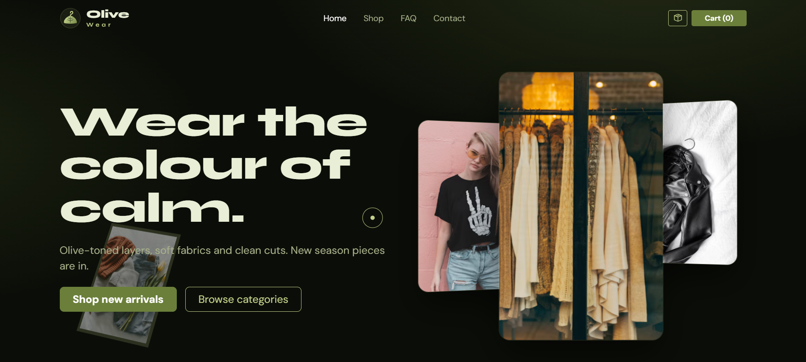
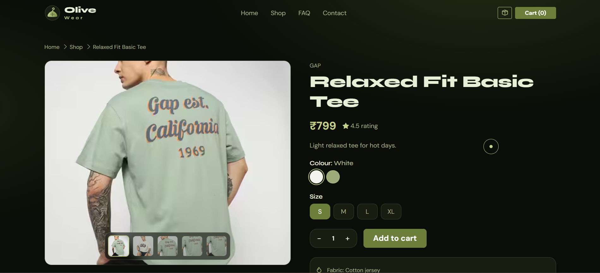
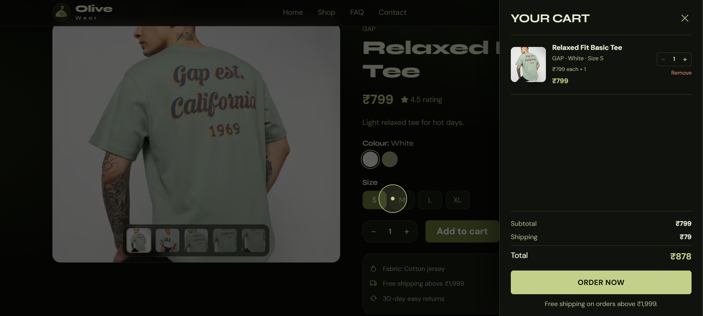
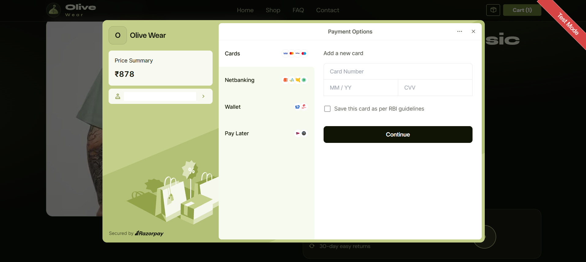
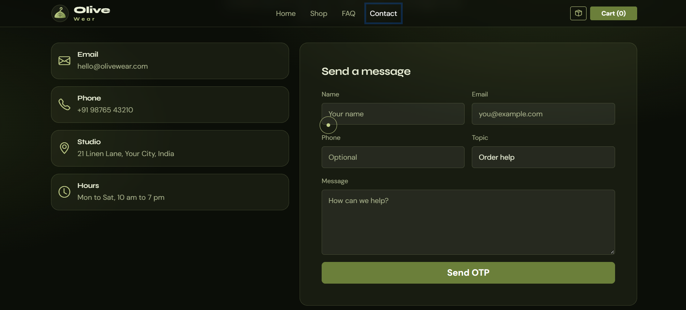
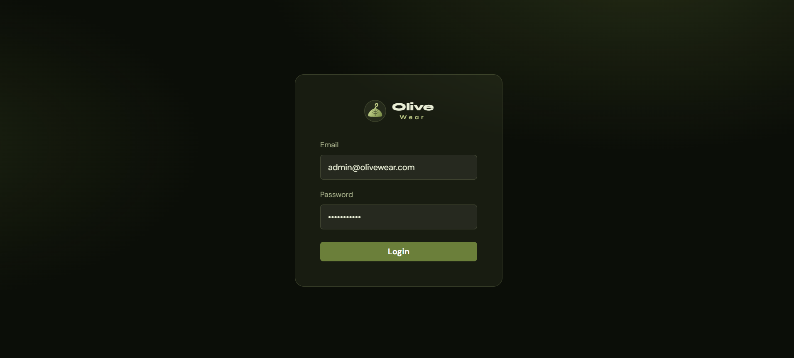
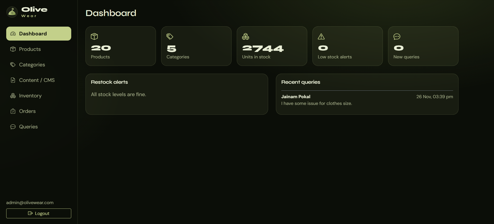

<div align="center">

<h1>🌿 Olive Wear</h1>

<p><b>A 3D animated, full-stack clothing store with a dark glassy olive theme.</b><br/>
React storefront · Express + MongoDB API · JWT admin panel · Razorpay payments · order tracking</p>

<p>
  
  
  
  
  
  
  
</p>



</div>

---

## Table of contents

- [About](#about)
- [Screenshots](#screenshots)
- [Features](#features)
- [Tech stack](#tech-stack)
- [Project structure](#project-structure)
- [Getting started](#getting-started)
- [Environment variables](#environment-variables)
- [Payments (Razorpay)](#payments-razorpay)
- [Order tracking](#order-tracking)
- [Admin panel](#admin-panel)
- [API overview](#api-overview)
- [Bulk upload (CSV)](#bulk-upload-csv)
- [Roadmap](#roadmap)
- [License](#license)

## About

**Olive Wear** is a clothing e-commerce project built end to end: a fast, responsive storefront with 3D scroll
animations, and a secure admin panel to manage everything from products and stock to orders and customer queries.

The whole site is dynamic. Clothes are added from the admin panel and appear on the storefront with their own
details page, gallery, stock and similar products. Customers can pay online with Razorpay, and the store owner
can follow every order from the admin panel.

## Screenshots

| Storefront | Product details |
| :---: | :---: |
|  |  |
| **Home** with 3D layered hero, custom cursor and glass UI | **Details page** with gallery thumbnails, size/colour and server-side quantity |

| Cart | Payment |
| :---: | :---: |
|  |  |
| **Cart drawer** with subtotal, shipping and total | **Razorpay checkout** (test mode): cards, netbanking, wallet, pay later |

| Contact (OTP verified) | Admin login |
| :---: | :---: |
|  |  |
| Email OTP is sent first, the query is saved only after verification | JWT protected admin at `/admin` |

**Admin dashboard**



## Features

### Storefront
- 🎞️ **3D and scroll effects**: layered mouse-tilt hero, Three.js scroll scene where clothes fly in and settle into place, reveal-on-scroll sections, animated intro screen and a custom pointer
- 🎨 **Dark glassy olive theme**, fully responsive with Bootstrap, no horizontal scroll on any screen
- 🛍️ **Dynamic catalogue**: category filters, product cards, product details page with gallery thumbnails, colour and size selection, and similar clothes
- 🔢 **Server-controlled quantity**: the `-` / `+` counter and stock limits are decided by the backend
- 🧺 **Cart drawer** with subtotal, shipping (free above ₹1,999) and total
- 💳 **Online payments** with Razorpay
- 📬 **Contact form with email OTP verification**, result shown as a toast
- 📖 **CMS driven pages**: lookbook, size guide, shipping, returns, terms and privacy
- 🔔 Reusable **toast** (react-toastify) and **confirmation popup** components

### Admin panel (`/admin`)
- 🔐 **JWT authentication**
- 📊 **Dashboard**: products, categories, units in stock, low stock alerts, new queries, recent queries
- 👕 **Products / catalogue**: list, add and edit with image upload, **bulk CSV upload**, categories and collections
- 📝 **Content / CMS**: homepage sections, lookbooks, size guides, policy pages
- 📦 **Inventory**: real-time stock by size, colour and location, restock alerts, warehouse stock summary
- 🧾 **Orders** with status tracking
- 💬 **Queries**: all verified contact form messages with status

## Tech stack

| Layer | Technology |
| --- | --- |
| Frontend | React 18, Vite, React Router, Bootstrap 5, Three.js, react-toastify |
| Backend | Node.js, Express, Mongoose |
| Database | MongoDB |
| Auth | JWT, bcrypt |
| Payments | Razorpay |
| Mail | Nodemailer (SMTP) for OTP emails |
| Uploads | Multer (images and CSV) |
| Security | Helmet, CORS, express-rate-limit |

## Project structure

```
olive-wear/
├── client/                      # React storefront + admin panel
│   └── src/
│       ├── api/                 # http wrapper, shop and admin API calls
│       ├── admin/               # /admin pages (dashboard, products, CMS, inventory...)
│       ├── components/          # shared UI (Navbar, Logo, ScrollScene, ui/ toast + confirm)
│       ├── hooks/               # useFetch, useScrollEffects
│       ├── pages/               # Home, ProductDetails, Contact, FAQ, Lookbook, ContentPage
│       └── styles/              # global.css, admin.css
├── server/                      # Express API
│   └── src/
│       ├── config/              # env, database
│       ├── models/              # Mongoose models
│       ├── services/            # business logic
│       ├── controllers/         # request handlers
│       ├── routes/              # public, auth and admin routes
│       ├── middleware/          # auth, upload, error handling
│       └── seed/                # demo data
└── docs/screenshots/            # images used in this README
```

## Getting started

**Requirements:** Node.js 18+, MongoDB (local or Atlas), a Razorpay account (test keys are free).

```bash
# 1. Clone
git clone https://github.com/<your-username>/olive-wear.git
cd olive-wear

# 2. Server
cd server
cp .env.example .env        # then fill in the values (see below)
npm install
npm run seed                # creates the admin user, categories, demo products and CMS pages
npm run dev                 # http://localhost:5000

# 3. Client (new terminal)
cd client
cp .env.example .env
npm install
npm run dev                 # http://localhost:5173
```

- Storefront: `http://localhost:5173`
- Admin panel: `http://localhost:5173/admin`

> The first admin account is created from `ADMIN_EMAIL` and `ADMIN_PASSWORD` in `server/.env`.
> Change them before deploying.

## Environment variables

No URL, key or credential is hard coded. Everything comes from `.env` files.

**`server/.env`**

| Variable | Description |
| --- | --- |
| `PORT`, `SERVER_URL`, `CLIENT_URL` | Server port, public server URL (used for uploaded image links), allowed client origin(s) |
| `MONGO_URI` | MongoDB connection string |
| `JWT_SECRET`, `JWT_EXPIRES_IN` | Token secret and lifetime |
| `ADMIN_NAME`, `ADMIN_EMAIL`, `ADMIN_PASSWORD` | First admin account |
| `SMTP_HOST`, `SMTP_PORT`, `SMTP_SECURE`, `SMTP_USER`, `SMTP_PASS`, `MAIL_FROM` | Mail server for OTP emails (leave `SMTP_USER` empty in development to print the OTP in the console) |
| `OTP_EXPIRY_MINUTES` | OTP validity |
| `MAX_QTY_PER_ORDER` | Maximum quantity per item |
| `RAZORPAY_KEY_ID`, `RAZORPAY_KEY_SECRET` | Razorpay API keys <!-- use the exact names from your .env.example --> |

**`client/.env`**

| Variable | Description |
| --- | --- |
| `VITE_API_URL` | API base URL, for example `http://localhost:5000/api` |
| `VITE_RAZORPAY_KEY_ID` | Razorpay **public** key id <!-- only if your client reads it from env --> |

> Never commit `.env` files or the Razorpay **secret** key. Both `.env` files are in `.gitignore`.

## Payments (Razorpay)

Checkout is handled by [Razorpay](https://razorpay.com/docs/payments/) and supports cards, netbanking, wallets and
pay later. The screenshots above are taken in **Test Mode**.

1. Customer adds items to the cart and clicks **Order now**.
2. The server creates the order and the Razorpay order.
3. Razorpay Checkout opens and the customer pays.
4. The payment result is confirmed by the server and the order is saved.

To test, use the test keys from your Razorpay dashboard and Razorpay's
[test card and UPI details](https://razorpay.com/docs/payments/payments/test-card-details/).

## Order tracking

Every order has a status that the store owner updates from **Admin → Orders**.
<!-- edit the list below to match the statuses used in your code -->

`Placed → Confirmed → Shipped → Delivered` (or `Cancelled`)

Payment state (paid or failed) is stored with the order so it is easy to see which orders are ready to ship.

## Admin panel

Open `/admin` and log in with the admin credentials from your `.env`.

| Section | What you can do |
| --- | --- |
| **Dashboard** | Totals, low stock alerts, latest queries |
| **Products** | Add, edit, hide or delete clothes; upload images; bulk upload CSV |
| **Categories** | Manage categories and collections shown on the store |
| **Content / CMS** | Edit homepage sections, lookbooks, size guide and policy pages |
| **Inventory** | Stock by product, colour, size and location; restock alerts; auto refresh every 10 seconds |
| **Orders** | See orders and update their tracking status |
| **Queries** | Read messages from the contact form and mark them read or resolved |

Destructive actions (logout, delete) always ask for confirmation.

## API overview

All routes are prefixed with `/api`.

| Access | Routes |
| --- | --- |
| Public | `GET /products`, `GET /products/:id`, `POST /products/:id/quantity`, `GET /categories`, `GET /content?type=`, `POST /contact/send-otp`, `POST /contact/verify` |
| Auth | `POST /auth/login`, `GET /auth/me` |
| Admin (Bearer token) | `/admin/dashboard`, `/admin/products` (+ `/bulk`, `/bulk/sample`), `/admin/categories`, `/admin/content`, `/admin/inventory`, `/admin/queries`, `/admin/upload` |

<!-- add your payment and order routes here, for example POST /orders, POST /payment/verify, /admin/orders -->

## Bulk upload (CSV)

Add many clothes at once from **Admin → Products → Bulk upload (CSV)**. Download the sample file from the same page.

```
name,category,collection,price,tag,img,gallery,description,fabric,sizes,colors,stock,location
```

- `sizes` separated by `|`, for example `S|M|L|XL`
- `colors` as `Name:#hex` separated by `|`, for example `Olive:#6b7f3a|Sand:#d9d2b6`
- `gallery` extra image URLs separated by `|`

## Roadmap

- [ ] Customer accounts and order history
- [ ] Wishlist
- [ ] Coupon codes
- [ ] Email notifications for order updates
- [ ] Product reviews

## License

Released under the [MIT License](LICENSE). Replace this section if you choose a different license.

---

<div align="center">
Made with 🌿 by <a href="https://github.com/<your-username>">Jainam Pokal</a>
</div>
